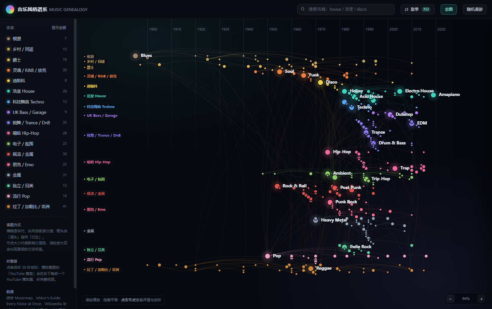

# Music Genealogy · 音乐风格谱系

An offline-friendly, single-page interactive **family tree of music genres**: time runs left → right, each family of genres sits on its own colour band, and arrows show who evolved from whom. Open any genre to see where it came from, how it sounds, its defining artists and a curated 5–8 track playlist with 30-second previews; to hear a whole set, jump to the matching YouTube playlist.

一个可以离线打开的单页交互式「音乐风格家谱」：按年代横向展开、按家族纵向分道，箭头表示「谁从谁演化而来」，点开任意风格能看到它的来历、听感特征、代表艺人与歌单（每个风格 5–8 首公认代表作），并直接试听 30 秒；想听整张，用谱系里已经建好的 YouTube 歌单链接过去连着听。



**Live · 在线版**: <https://musicgenealogy.pillar.fun> （备用 <https://music-genealogy.vercel.app>）— 中文默认，右上角 `中文 / EN` 切换，或直接打开 <https://musicgenealogy.pillar.fun/?lang=en>。

**Languages / 语言**: 中文 · English — switch with the `中文 / EN` buttons in the top bar, or link straight to a language: `/?lang=en`.

---

## English

### Open it

Double-click `start.cmd` (Windows) or run `node serve.js` (macOS / Linux): it starts a local-only server and opens `http://127.0.0.1:8123/`.

- Opening `index.html` directly (`file://`) also works — chart, search, filters, drawer and 30-second previews all run; previews fall back to JSONP so there is no CORS problem.
- Any static host works the same way; see [Deploy](#deploy).
- Everything ships in files: no install, no build step. The chart itself (nodes, edges, filters, search) is fully offline. Only "preview 30s", genre artwork and the YouTube playlist links need the network — artwork is cached locally after the first fetch.

On first open you get the whole map: 17 family bands, a 1900–2020 timeline and 352 genre nodes. Zoom with the wheel / pinch, pan by dragging, use the zoom buttons bottom-right, and hit "Reset" (top-right) to fit everything again.

### Reading the map

| Element | Meaning |
| --- | --- |
| Horizontal axis | Year (1900 → 2020); the top ruler gets denser/sparser as you zoom |
| Vertical | Each family owns a colour band, sub-branches stack inside it |
| Arrows | Point from a "source" genre to its "descendant"; selecting a genre highlights only its lineage |
| Edge colour | With a genre selected: **ice blue = ancestors** (flowing into it), **warm gold = descendants** (flowing out of it); direct edges are brightest with a glow, more distant lineage stays as a faint backdrop |
| Node size | Influence tier: hub > main > niche |
| Left capsules | Family names, pinned to the left edge of the canvas while zooming/panning |
| Colour | Family colour, matching the family list on the left |

### Interactions

- **Search** — type an English or Chinese fragment (`house`, `浩室`, `disco`, `酸性`); ↑↓ to choose, Enter to jump.
- **Click a node** — the drawer shows year, origin, typical BPM and history; the stage background cross-fades to that genre's artwork (first track's album cover, blurred) with a sharp, darkened copy in the drawer and a 58px thumbnail top-left; sound-and-feel tags; direct predecessors / descendants (clickable, so you can walk the tree); defining artists; the **playlist** (5–8 tracks — click one for a 30-second Apple Music preview, or "Play all" to preview them in order, skipping tracks without a preview); YouTube search and a Wikipedia link.
- **Playlist overview** — the "Playlists" button in the top bar (with a count badge) browses every genre playlist by family; search a genre name, click a card to open that genre.
- **YouTube playlists** — three levels: the genre's own official playlist if it exists (`js/yt-genre-playlists.js`, 5–8 tracks each, currently being built genre by genre) → otherwise its family's 30-track playlist (`js/yt-playlists.js`) → otherwise an ad-hoc `watch_videos?video_ids=…` playlist (no login, created on the fly, savable in YouTube). "Copy link" copies the current link.
- **Family filter** — click a family on the left to isolate it; "All" restores everything.
- **Random walk** — jumps to a random genre.
- **Shortcuts** — `/` focuses search, `Esc` closes the drawer / search.
- **Deep links** — `index.html#acid-house` opens that genre directly; add `?lang=en` for English.

### Data

- 352 genres, 402 source tracks, 17 families: Roots · Country/Folk · Jazz · Soul/R&B/Funk · Disco · House · Techno · UK Bass/Garage · Rave/Trance/DnB · Hip-Hop · Electronic/Ambient · Rock · Punk/Emo · Metal · Indie/Alternative · Pop · Latin/Caribbean/Africa.
- Each genre also has a **curated 5–8 track playlist** (352 playlists, ~2,100 tracks, including the source tracks) in `js/playlists.js`:

```js
// window.MG_PLAYLISTS[genreId] = [[title, artist, year], ...]
window.MG_PLAYLISTS = {
  "acid-house": [["Acid Tracks", "Phuture", 1987] /* … 6 tracks */],
};
```

- Five families already have a real 30-track YouTube playlist, **public** on the `pill4r_` channel:

| Family | Playlist | Years |
| --- | --- | --- |
| Roots | [谱系 · 根源 Roots｜福音 · 布鲁斯 · 民谣](https://www.youtube.com/playlist?list=PLNtC24x8iadY) | 1927–1955 |
| Rock | [谱系 · 摇滚 Rock｜从 Rock'n'Roll 到迷幻](https://www.youtube.com/playlist?list=PLRbh8bgTkTB0) | 1954–1967 |
| Soul | [谱系 · 灵魂 Soul｜福音驱动的节奏](https://www.youtube.com/playlist?list=PLSO-NG8PUOWI) | 1946–1966 |
| Disco | [谱系 · 迪斯科 Disco｜1970s 舞池革命](https://www.youtube.com/playlist?list=PLdzTczYJl4Do) | 1975–1982 |
| House | [谱系 · 浩室 House｜芝加哥 1980s 起源](https://www.youtube.com/playlist?list=PLITFK2wbKVbU) | 1984–1991 |

  Their ids / titles / track counts / year spans live in `MG_YT_PLAYLISTS` (`js/yt-playlists.js`).
- Genre playlist ids are generated into `js/yt-genre-playlists.js` (`MG_YT_GENRE_PLAYLISTS`) by `.tools/yt-genre-sync.mjs` — do not edit by hand. Building them is rate-limited by the YouTube Data API quota (10,000 units/day; a playlist + 6–8 tracks costs ~350–450).

```js
// genre record (js/data-*.js)
{
  id: "acid-house",        // unique id, used for anchors and relations
  n: "Acid House",         // English name
  zh: "酸性浩室",           // Chinese name
  f: "house",              // family id
  y: 1986,                 // approximate year of origin
  r: "美国·芝加哥",          // origin
  bpm: "120-130",          // typical BPM
  tier: 2,                 // 1 hub / 2 main / 3 niche
  d: "用 Roland TB-303……",  // history & characteristics
  ch: ["TB-303 酸性音色"],   // sound & feel tags
  ar: ["Phuture"],         // defining artists
  tr: [["Acid Tracks", "Phuture", 1987]], // source tracks
  p: ["chicago-house"]     // direct predecessors
}
```

Add a genre by appending one entry to the right `data-*.js` array — layout, edges, drawer and search pick it up automatically. Families live at the top of `js/data-1.js` and `js/data-5.js` (`FAMILIES`).

Playlists can be rebuilt: `.tools/playlists/genres.json` is the exported genre list, curated tracks live in `.tools/playlists/curated/<family>.json`, and `node .tools/playlists/build.js` regenerates `js/playlists.js` and prints coverage and problems (fewer than 5 tracks, duplicate titles, odd years).

### Internationalisation

- `js/i18n.js` holds the Chinese base strings plus the API: `t(key, vars)`, `setLang(code)`, `MG_I18N.register(code, pack)` for UI strings, `MG_I18N.registerContent(code, genres)` for translated genre content.
- `js/locales/en.js` — English UI strings and the 17 family names/subtitles. `js/locales/en.genres.js` — generated English `{n, r, d, ch}` for all 352 genres (`.tools/i18n/merge.mjs`, validated for completeness and for leftover Chinese).
- Static markup uses `data-i18n`, `data-i18n-html` and `data-i18n-attr="attr:key,..."`; language choice is resolved from `?lang=` → `localStorage["mg:lang"]` → `navigator.languages` → Chinese, and the switcher writes `?lang=` back into the URL.
- Chart labels always use the English name so the layout never jumps; switching language re-labels everything in place (no rebuild, so zoom and scroll position survive).
- **Adding a language**: copy `js/locales/en.js`, translate the strings and family names, register it with a new code (e.g. `de`), add `<script src="js/locales/de.js">` after `js/i18n.js` and drop a translated content file next to it — the switcher grows automatically.

### Local dev

```bash
node serve.js            # http://127.0.0.1:8123
```

Tests / tooling (Node 20+):

```bash
cd .tools/i18n && npm install          # jsdom, used by the smoke test
node .tools/i18n/extract.mjs           # export genre data for translation
node .tools/i18n/merge.mjs             # rebuild js/locales/en.genres.js and validate
node .tools/i18n/smoke.mjs             # headless DOM test of the zh + en UI
```

`smoke.mjs` loads the real `index.html` in jsdom (with a stubbed ECharts) and asserts the Chinese default, the English switch, `?lang=en` deep loading, translation-key coverage and that no Chinese literals are left in `app.js`.

### Deploy

The site is plain static files, so it deploys to Vercel as-is (no framework, no build command, output = repository root):

```bash
vercel --prod            # or import the GitHub repo in the Vercel dashboard
```

`vercel.json` only sets long-lived caching for `vendor/` and the locale packs. Any static host (GitHub Pages, Cloudflare Pages, Netlify, S3) works too.

**Automatic deploys**: the Vercel project is linked to this repository through the Vercel GitHub App, so every push to `main` builds a production deployment and moves <https://musicgenealogy.pillar.fun> to it. Pull requests get preview URLs in the Vercel dashboard.

### Why only 30 seconds in-page

Only Apple Music's 30-second preview is played in-page; full playback is handed to YouTube, so no account is needed and the embedded-player issues (Referer, copyright, region) disappear.

| Option | In-page? | Full track | Requirements |
| --- | --- | --- | --- |
| iTunes Search API (current) | yes | 30s excerpt | none |
| YouTube embed iframe (removed) | yes | yes | copyright/region limits, ads, breaks on `file://` |
| YouTube audio stream parsing | no longer possible | no | API blocked |
| Spotify Web API | no audio stream | — | OAuth + Premium |
| Spotify embed | preview only when logged in | no | login |

### Credits

Years, family grouping and "direct predecessor" links are an approximate, educational synthesis of Musicmap, Ishkur's Guide to Electronic Music, Every Noise at Once, Wikipedia and AllMusic. Sources disagree on some classifications — edit `js/data-*.js` freely.

---

## 中文

### 打开方式

推荐双击 `start.cmd`（Windows；macOS / Linux 用 `node serve.js`）：它会起一个只监听本机的小服务器，并自动用浏览器打开 `http://127.0.0.1:8123/`。

- 双击 `index.html`（`file://`）也能用：谱系、搜索、筛选、抽屉、30 秒试听都正常——试听在 `file://` 下会自动走 JSONP，不受跨域限制。
- 用 `start.cmd` 或任意静态服务器（如 `python -m http.server`）通过 `http://` 打开效果一样，只是地址栏更干净、缓存策略更正常。
- 所有前端资源都在文件里，不用安装、不用构建；谱系本身（节点、连线、筛选、搜索）完全不联网，只有「试听 30 秒」「风格封面」和点开 YouTube 歌单链接需要联网——封面取过一次就存在本机，之后再看不用再请求。
- 首次打开会看到全图：17 个家族色带、1900–2020 年代标尺、352 个风格节点。
- 滚轮/双指缩放，拖拽平移，右下角有缩放按钮，右上「全图」一键复位。

### 怎么读这张图

| 元素 | 含义 |
| --- | --- |
| 横轴 | 年代（1900 → 2020），顶部标尺随缩放自动加密/稀疏 |
| 纵向 | 每个「家族」占一条色带，带内再按支系分层 |
| 箭头 | 由「源头」指向「衍生」；选中某风格时只高亮它的整条谱系 |
| 线色 | 选中风格后，**冰蓝 = 前驱**（箭头流向它），**暖金 = 后继**（从它演化出去）；直接相连的几条最亮并带光晕，再远只留一层淡色当背景 |
| 节点大小 | 影响力层级：枢纽 > 主干 > 细分 |
| 左侧胶囊 | 家族名；缩放/平移时始终贴在画布左缘 |
| 颜色 | 家族色，与左侧家族列表一致 |

### 交互

- **搜索**：顶部输入 `house`、`浩室`、`disco`、`酸性` 等中英文片段，↑↓ 选择、回车定位。
- **点节点**：右侧抽屉显示起源年代、发源地、典型 BPM、一段来历说明；整块舞台背景会换成该风格的代表作封面（模糊压暗），抽屉里是同一张封面压暗后的清晰版本 + 左上角 58px 缩略图；下面依次是听感特征标签、直接源头 / 衍生风格（可点击跳转）、代表艺人、**歌单**（5–8 首，点曲目听 30 秒 Apple Music 试听，「▶ 连播 30 秒」依次试听，取不到片段的自动跳过）、YouTube 搜风格 / Wikipedia 外链。
- **歌单总览**：点顶部「歌单」按钮（带数量角标），按家族浏览全部风格歌单；可搜索风格名，点卡片直接跳到该风格详情。
- **YouTube 歌单**：链接分三级——先看这个风格自己有没有正式歌单（`js/yt-genre-playlists.js`，每张 5–8 首），有就直接打开；没有就看所属家族有没有整张歌单（`js/yt-playlists.js`，5 个家族各 30 首）；都没有才退回 `watch_videos?video_ids=…` 临时歌单（免登录、打开即建，可在 YouTube 里保存）。「复制链接」把当前链接复制走。
- **家族筛选**：点左侧家族只看该家族；「显示全部」恢复。
- **随机漫游**：随机跳到一个风格。
- **快捷键**：`/` 聚焦搜索，`Esc` 关闭抽屉/搜索。
- **深链**：`index.html#acid-house` 直接打开该风格详情，加 `?lang=en` 看英文版。

### 数据

- 352 个风格、402 首原始代表曲、17 个家族，覆盖 根源 · 乡村/民谣 · 爵士 · 灵魂/R&B/放克 · 迪斯科 · 浩室 · 科技舞曲 · UK Bass/Garage · 锐舞/Trance/DnB · 嘻哈 · 电子/氛围 · 摇滚 · 朋克/Emo · 金属 · 独立/另类 · 流行 · 拉丁/加勒比/非洲。
- 每个风格另有一份 **5–8 首的精选歌单**（共 352 份、约 2,100 首），数据在 `js/playlists.js`：`window.MG_PLAYLISTS[风格id] = [[曲名, 艺人, 发行年], ...]`。
- 其中 5 个家族已经建成了真正的 YouTube 整张歌单（各 30 首、按年代排序，已在 `pill4r_` 频道上**公开**），见上表；id / 标题 / 首数 / 年代写在 `js/yt-playlists.js`。
- 在此之上还在做 **每个风格一张自己的歌单**（352 张），进度写在 `js/yt-genre-playlists.js`，由 `.tools/yt-genre-sync.mjs` 自动生成，不要手改。批量建单受 YouTube Data API 每天 10,000 单位配额限制。
- 风格数据结构见上方英文示例（`id`/`n`/`zh`/`f`/`y`/`r`/`bpm`/`tier`/`d`/`ch`/`ar`/`tr`/`p`）。新增风格只需在对应 `data-*.js` 的数组里加一条，布局、连线、抽屉、搜索会自动生效。家族定义集中在 `js/data-1.js` 与 `js/data-5.js` 顶部的 `FAMILIES`。
- 歌单数据可以重新生成：`.tools/playlists/genres.json` 是从 `data-*.js` 导出的清单，人工整理好的曲目放在 `.tools/playlists/curated/<family>.json`，跑 `node .tools/playlists/build.js` 合成 `js/playlists.js` 并打印覆盖率与问题清单。

### 多语言

- `js/i18n.js` 里是中文基础文案和 API：`t(key, vars)`、`setLang(code)`、注册界面文案的 `MG_I18N.register(code, pack)`、注册内容翻译的 `MG_I18N.registerContent(code, genres)`。
- `js/locales/en.js`：英文界面文案 + 17 个家族名；`js/locales/en.genres.js`：352 个风格的英文 `{n, r, d, ch}`，由 `.tools/i18n/merge.mjs` 生成并校验（文案齐全、无中文残留）。
- 静态文案用 `data-i18n` / `data-i18n-html` / `data-i18n-attr="attr:key,..."` 标注；语言按 `?lang=` → `localStorage["mg:lang"]` → 浏览器语言 → 中文 的顺序识别，手动切换后会把 `?lang=` 写回地址栏。
- 图上标签始终用英文名，避免切换语言时布局跳动；切换语言时原地重渲（不 `rebuild()`，缩放和位置都保留）。
- **加一门语言**：复制 `js/locales/en.js` 翻译界面与家族名，用新的语言代码注册（例如 `de`），在 `js/i18n.js` 之后加一行 `<script src="js/locales/de.js">`，再放一份内容翻译文件即可，切换器会自己多出一个按钮。

### 技术

- 纯静态：`index.html` + `css/style.css` + `js/app.js` + 10 个数据文件 + `js/playlists.js` + `js/videos.js`（YouTube videoId 索引）+ `js/yt-playlists.js` + `js/yt-genre-playlists.js` + `js/i18n.js` 与 `js/locales/`。
- 图表用本地 `vendor/echarts.min.js`（ECharts 5.5.1，graph + 自定义坐标）；时间轴/家族胶囊/年代标尺是 HTML 覆盖层，与 ECharts 的坐标变换实时同步。
- 标签避让：按屏幕坐标做矩形碰撞剔除，放大后逐级显示更细的分支标签。
- **试听 30 秒**：iTunes Search API（`file://` 下走 JSONP），取 `previewUrl` 的 30 秒片段，免密钥、免登录。
- **谱系线配色**：`restyle()` 里按 `l.target === 选中点 || 祖先集合.has(l.target)` 判定前驱（`#63e8ff`）/ 后继（`#ffc857`），谱系内的线挂 `symbol: ["none","arrow"]` 画出方向；非谱系的线压到 `opacity .035`。
- **风格封面**：`findArtwork()` 复用 iTunes 搜索结果，把 `artworkUrl100` 换成 `600x600bb` 取大图，按风格 id 缓存在 `localStorage` 的 `mg:art:<id>`。同一张图用在 `#stageCover`（铺满舞台）和抽屉 `.dw-cover`。
- **播放条**：底部一条，封面 / 曲名 / 播放暂停 / 进度 / 剩余秒数 / 关闭；「▶ 连播 30 秒」把当前歌单排成队列依次试听。
- **YouTube 歌单**：`js/videos.js` 是「艺人|曲名 → videoId」静态索引（离线批量生成，当前 2,031 条），用来给还没有正式歌单的风格拼临时歌单链接；没有索引的曲目退回 YouTube 搜索页。
- **页面里不再嵌入 YouTube 播放器**：官方 iframe 在 `file://` 下报错 153、还会被版权方关掉嵌入，而 `youtubei/v1/player` 已拿不到音频流；整张交给 YouTube 自己的播放器更稳。

### 部署

纯静态文件，直接部署到 Vercel 即可（无需框架、无构建命令，输出目录就是仓库根目录）：

```bash
vercel --prod            # 或在 Vercel 面板里 Import 这个 GitHub 仓库
```

`vercel.json` 只给 `vendor/` 和语言包设了长缓存。GitHub Pages、Cloudflare Pages、Netlify、S3 等任何静态托管都同样可用。

**自动部署**：Vercel 项目已通过 Vercel GitHub App 与本仓库关联，每次 push 到 `main` 都会生成一次生产部署，并把 <https://musicgenealogy.pillar.fun> 指到新版本；PR 会在 Vercel 面板里得到预览地址。

### 数据来源与免责

年代、家族归类与「直接源头」关系综合参考 Musicmap、Ishkur's Guide to Electronic Music、Every Noise at Once、Wikipedia 与 AllMusic，属于科普性近似梳理；不同资料对某些流派的归类会有出入，可自行调整 `js/data-*.js`。
